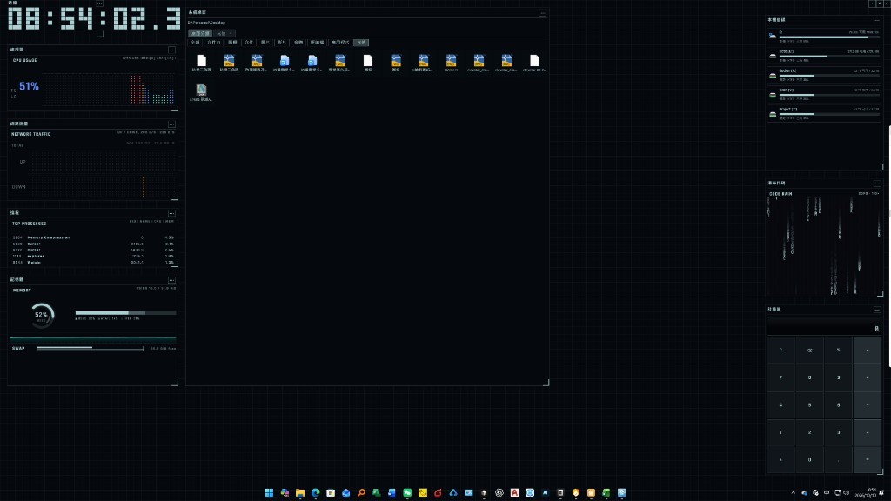
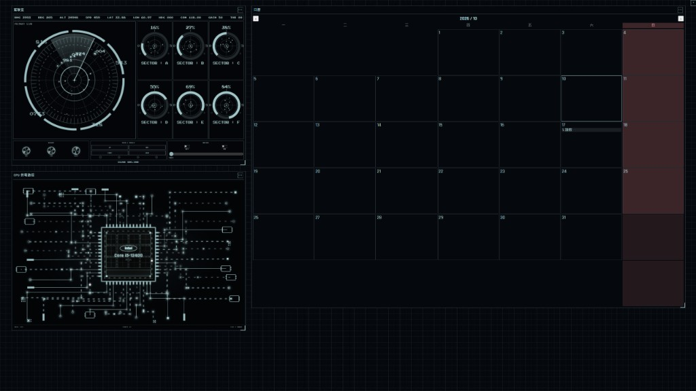

# eDEX Desktop Organizer

Ein auf [eDEX-UI](https://github.com/GitSquared/edex-ui) basierendes **Windows-Desktop-Organisationstool für mehrere Monitore**.
Es übernimmt die futuristische Terminal- und Hacker-Ästhetik von eDEX (fast schwarzer Hintergrund, Cyan-Weiß-Farben, Raster-Hintergrund und HUD-Container) und macht aus der ursprünglichen Vollbildoberfläche eine dauerhaft über dem Systemdesktop nutzbare Arbeitsoberfläche.

## Projektbeschreibung

Dieses Projekt ist kein Terminal-Emulator wie das originale eDEX, sondern:

1. **Übernimmt die visuelle Sprache und die Panel-Struktur von eDEX**
   Theme-Farben, Schriftarten, Rahmen, Globus, Code-Regen sowie CPU-, Speicher- und Netzwerk-Überwachung stammen aus den eDEX-Themes und den Modul-CSS-Dateien.
2. **Erweitert eDEX zu einer Desktop-Organizer-Oberfläche**
   Transparente Overlay-Fenster bedecken jeden Monitor, blenden die Windows-Desktopsymbole aus und bieten stattdessen Container für Dateien, Verknüpfungen, Laufwerke und Kalenderfunktionen.
3. **Bietet einen durchgängigen Hacker-Desktop-Stil**
   Dunkler Raster-Hintergrund, kantige Rahmen, Monospace- und Sci-Fi-Schriften sowie halbtransparente Panel-Ebenen erzeugen eine terminalartige Desktop-Atmosphäre.

| eDEX-Grundidee | Umsetzung in diesem Tool |
| --- | --- |
| SYSTEM-Seitenleiste | Container für Uhr, Prozessor, Speicher, Prozesse und Netzwerkverkehr |
| Zentrale TERMINAL-Fläche | Systemdesktop und Pfad-Container mit Datei-Raster oder Listenansicht |
| NETWORK-Seitenleiste | Lokale Laufwerke, Globusansicht, Code-Regen und Taschenrechner |
| FILESYSTEM / KEYBOARD | Schnellsuche, Kalendereinträge, Container-Menüs und Einstellungen |

## Screenshots

### Gesamter Hacker-Desktop

Überwachungs-Panels auf beiden Seiten, der zentrale Systemdesktop-Container sowie Laufwerke, Code-Regen und Taschenrechner vor einem Raster-Hintergrund.



### Cockpit-Radar, CPU-Versorgungspfad und Kalender

Überlagerbare Plugin-Container: Radar-Cockpit, Darstellung des CPU-Kernpfads sowie Kalender mit Feiertagen und Terminvorschau.



### Systemdesktop-Container

Filterung nach Kategorien wie Ordner, Symbole, Dateien und Bilder; mit Tabs, Kontextmenü zum Aktualisieren und automatischen Sortieren, Datei-Drag-and-drop sowie schneller Aktualisierung.


## Hauptfunktionen

- **Mehrmonitor-Unterstützung**: Eigenes Fenster pro Monitor; der **Systemdesktop wird nur auf dem Hauptmonitor angezeigt**; die Rasterdichte wird mit dem Maßstab des Hauptmonitors synchronisiert.
- **Container-System**: Verschieben, Skalieren, Sperren und Hintergrundfarbe ändern; neue Container lassen sich nacheinander hinzufügen und suchen automatisch freie Rasterzellen.
- **Systemdesktop**: Filter, Tabs, Kontextmenü für „Inhalt aktualisieren“ und „Automatisch sortieren“, schnelle Aktualisierung nach externem Drag-and-drop.
- **Pfad-Container**: Ordner als eigenständige Browserbereiche hinzufügen; neue Ordner werden nach Eingabe eines Namens erstellt.
- **Plugins**: Taschenrechner, Musik-Kassette, Cockpit, CPU-Versorgungspfad, Code-Regen, Kalender und weitere.
- **Kalendereinträge**: Datum doppelt anklicken, um Einträge zu bearbeiten; Einträge können nach WeChat kopiert werden.
- **Schnellsuche**: Dateinamensuche auf lokalen Laufwerken und in zusätzlichen Stammverzeichnissen.
- **Theme-Hintergründe**: eDEX-Theme-JSON-Dateien sowie Raster-, Scanline- und weitere Hintergrundstile.

## Ausführen

```powershell
cd organizer
npm install
npm start
```

## Windows-Installer erstellen

```powershell
cd organizer
npm install
npm run dist
```

Ergebnis: `dist/eDEX-Desktop-Organizer-Setup-<version>.exe` (NSIS-Installer, Installationsverzeichnis kann geändert werden).

## Veröffentlichung

- Repository: https://github.com/bananamax9113/Bockis-eDEX_Desktop_UI
- Releases: https://github.com/bananamax9113/Bockis-eDEX_Desktop_UI/releases

## Lizenz und Quellen

- Dieses Tool verwendet die visuelle Gestaltung und Teile der Frontend-Ressourcen von eDEX-UI (GPL-3.0).
- Themes und Modul-Stile orientieren sich an `src/assets` und dem originalen eDEX-CSS.
- Ergänzende Informationen zur Farbgestaltung stehen in [`tron-theme.md`](tron-theme.md).
